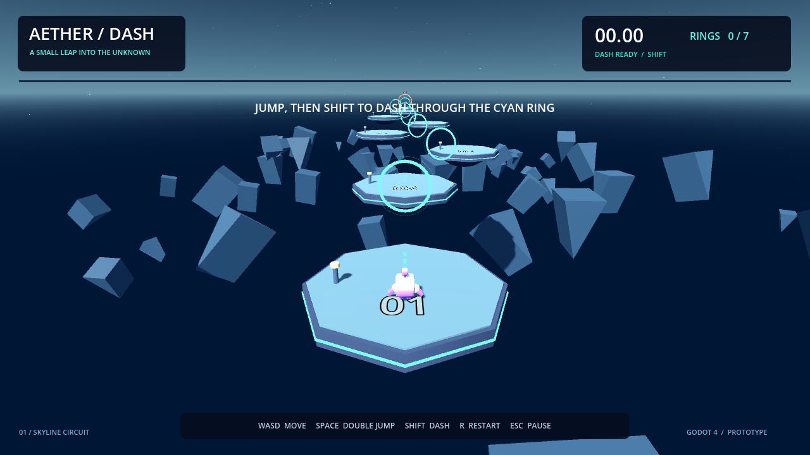

# Aether Dash

A small 3D movement prototype: jump between floating islands, dash through cyan rings to recover energy, and finish the circuit.

**Godot 4.7.2 · GDScript · Windows x86-64 · keyboard**



## Play

Run `AetherDash.exe` from the Windows release. No editor or separate PCK file is needed. For source, import `project.godot` in Godot 4.7.2 and press F5.

- WASD: move; forward is toward the horizon.
- Space: jump, then press again for a double jump.
- Shift: dash in the current or last movement direction.
- Landing or entering a fresh cyan ring refills one dash charge.
- Collect all seven rings and enter the final island's finish zone to win, on foot or while dashing through the air.
- R: restart the full run. Falling also resets the run. There are no checkpoints.
- Escape: pause/resume. Reduced motion is available in the pause menu.

Tip: approach an island's edge, jump, then dash toward the next ring. Use the second jump to correct height. Each ring restores energy once per run. A practiced input replay completes the course in approximately 14 seconds; a first attempt may take multiple restarts.

## Attribution and scope

This is an **AI-assisted first Godot portfolio prototype**, separate from the employer's checkpoint/respawn test. Development used substantial Codex assistance for design, code, debugging, testing and packaging. It should not be represented as unaided work or professional Godot experience.

New work under `dash/`: controller with bounded dash recovery, jump buffering and coyote time; ring state; procedural eight-island course/environment; following camera and dash FOV feedback; timer, finish/restart/pause UI; local best-time saving; sound and visual feedback. Tests use real engine objects and input-driven traversal.

Starting repository: [Kenney Starter Kit 3D Platformer](https://github.com/KenneyNL/Starter-Kit-3D-Platformer), MIT. Character, animation and sound assets: Kenney CC0. The active controller and course are new scripts. Original starter folders remain for reference, not active gameplay. Original README: `docs/KENNEY_README.md`. MIT terms: `LICENSE.md`.

## Code map

- `dash/dash_player.gd`: CharacterBody3D movement, jump state, charge, dash recovery.
- `dash/energy_ring.gd`: Area3D trigger, one recharge per run, reset-safe fade.
- `dash/course.gd`: procedural course, progression, timer, camera, audio and run state.
- `dash/hud.gd`: HUD and always-active pause/restart input.

Movement parameters are exported. Course positions are the `STOPS` array. The level is built at runtime: the editor initially shows only the root; inspect the Remote scene tree while playing. Pausing stops gameplay while HUD input remains active.

## Verify and rebuild

Run from the source directory with Godot 4.7.2 on PATH:

```text
godot --headless --path . --script res://tests/test_game.gd
godot --headless --path . --script res://tests/test_course.gd
godot --headless --path . --script res://tests/test_finish.gd
godot --headless --path . --script res://tests/replay.gd --fixed-fps 60
```

Replay drives normal input actions, physics and ring triggers. It does not teleport the player or override movement velocity. Videos identify this as an automated real-input replay, not a human playtest; the showcase also includes slow-motion excerpts.

Install the matching official **4.7.2 export templates** before rebuilding on another computer. The Windows preset contains no machine-specific template path.

```text
godot --headless --path . --export-release "Windows Desktop" ../Windows/AetherDash.exe
```

## Limits

One short course and keyboard controls. No rebinding, gamepad dash binding, camera collision or music. Reduced motion disables dash FOV and trail feedback. Automated traversal and render checks do not replace human testing of game feel. Best time is local. Demo scripts use no network services or telemetry.

